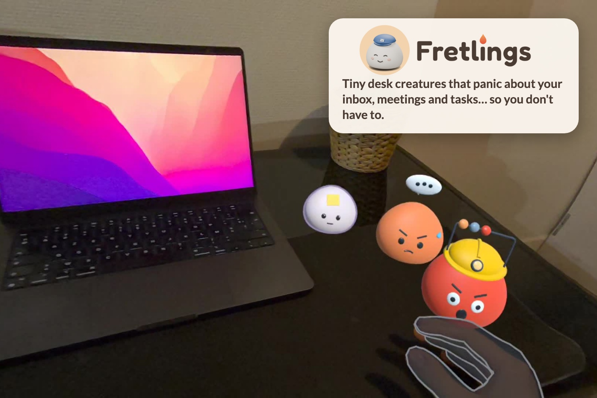

<p align="center"></p>

<p align="center"><b>Your inbox, meetings and to-dos live on your real desk as tiny mixed-reality creatures that panic so you don't have to.</b></p>

<p align="center"></p>

Fretlings puts five small creatures next to your keyboard, in mixed reality. Each one watches part of your work day and gets visibly stressed when something needs you: it heats up, grows, sweats, and small flames rise behind the mail creature's cap. Look at it, pinch, handle the items, and it sighs with relief. Built for **Meta Quest 3 / 3S** and **Meta VR Glasses**, hands only. Productivity track of the Meta VR Start Developer Competition 2026.

| Creature | Watches |
|---|---|
| **Mail** | important unread mail, and how long it has waited |
| **Calendar** | the next meeting coming closer |
| **Tasks** | tasks due today or overdue |
| **Messages** | people waiting for an answer |
| **Agents** | AI coding sessions: running, waiting for you, done, failed |

## Features

- **Hand-based desk calibration**: lay your hand flat on the desk; no room scan required.
- **Persistent spatial anchors**: the creatures come back where you left them, desk after desk.
- **Look and pinch**: head gaze with an outline and a peek bubble, pinch to open the most urgent items, pinch a line to mark it read or done.
- **Grab and drop** with a bounce, procedural animation, original sounds, a first-run walkthrough with no wall of text.
- **Two data modes**: a scripted **Demo** (default, no account) and **Live** mode, which reads your real mail, calendar, tasks and coding-agent sessions through the [desktop companion](Companion/README.md).

## Project layout

| Path | Contents |
|---|---|
| `Assets/_Project/Scripts/` | the app: creatures, desk, interaction, UI, data sources (`Data/Demo`, `Data/Live`) |
| `Assets/_Project/Editor/ProjectSetup.cs` | generates the prefabs, scenes and settings (`Deskmates > Setup` menu, or headless) |
| `Assets/_Project/Tests/` | EditMode and PlayMode tests |
| `Companion/` | the desktop companion for Live mode |
| `SourceArt/` | creature models (Blender script), sounds and music generators, logo, video edit |
| `PRD.md`, `STYLE.md` | product requirements and visual style |

## Build

Unity 6 (6000.6.5f1), URP, Meta XR Core SDK, Interaction SDK and MR Utility Kit 207. Open the project, then **File > Build Profiles > Meta Quest > Build**. Data mode: `Assets/_Project/Settings/Data/DataSettings.asset`.

Tests, headless:

```bash
Unity -batchmode -projectPath . -runTests -testPlatform EditMode -testResults results.xml
```

Every model, sound and piece of music in this repository is original; see [CREDITS.md](CREDITS.md).
